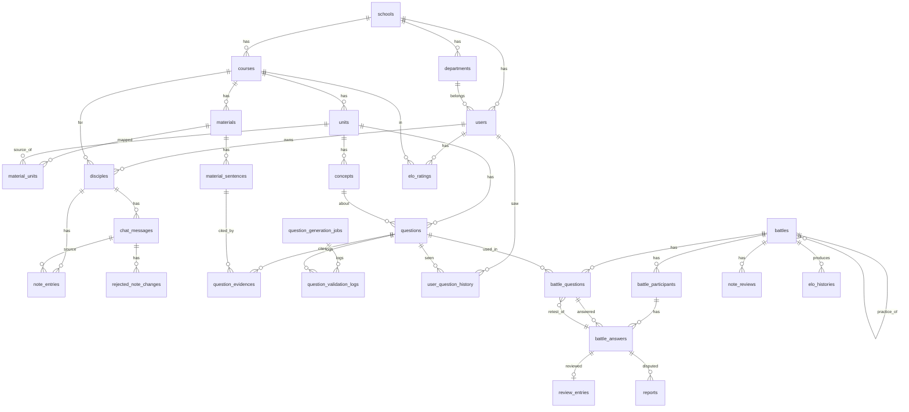

# DB 설계 (ERD)

> **상태: 설계 초안 (구현 전).** 팀 합의 후 `src/main/resources/db/migration/V1~V8`로 옮긴다.
> 작업 순서·결정 사항은 [backend-plan.md](backend-plan.md), API는 [api-spec.md](api-spec.md).

## 1. 공통 규칙

| 항목 | 규칙 |
|---|---|
| 테이블·컬럼명 | `snake_case`, 테이블은 복수형 |
| PK | 모든 테이블 `id BIGINT AUTO_INCREMENT` |
| 시각 | `DATETIME(6)`, **UTC**. 아래 표에서 `CU` = `created_at`+`updated_at`(BaseTimeEntity), `C` = `created_at`만(추가 전용 로그) |
| 시각 기본값 | `DEFAULT CURRENT_TIMESTAMP`를 **쓰지 않는다.** (설치형 MySQL은 서버 시간대가 KST라 UTC가 깨진다) 앱이 채우고, 시드 SQL은 `UTC_TIMESTAMP(6)`를 쓴다 |
| enum | DB `ENUM` 타입을 쓰지 않고 `VARCHAR`로 저장한다 (값 추가 때 ALTER가 필요 없다). 값 목록은 3절 |
| JSON | MySQL `JSON` 타입. JPA에서 `@JdbcTypeCode(SqlTypes.JSON)`. 4절에 구조 정의 |
| FK | 모두 명시. 기본 `ON DELETE RESTRICT`. `CASCADE`는 "부모가 없으면 의미 없는 자식"에만 (`material_sentences`, `material_units`, `question_evidences`) |
| 삭제 | 사용자 데이터는 **물리 삭제하지 않는다.** 상태값(`DELETED`, `RETIRED`, `WITHDRAWN`)으로 처리한다. 단, 단순 연결 정보(`material_units`)는 연결을 풀 때 행을 지운다 |
| 문자셋 | `utf8mb4`, collation `utf8mb4_0900_ai_ci` (이메일·닉네임 UNIQUE가 대소문자 무시로 동작) |
| 추가 전용 테이블 | `C`만 쓰는 테이블용으로 `BaseCreatedEntity`(createdAt만)를 `global/jpa`에 추가한다 |

테이블은 총 **28개**다. 마이그레이션은 외래키 순서에 맞춰 8개 파일로 나눈다(5절).

**용어**: 문서와 코드의 **단원(unit)은 곧 주차**다. 테이블 이름 `units`는 그대로 두고, 학생 화면에서만 "주차"라고 부른다.

## 2. 관계도

핵심 흐름: `users → disciples(과목당 1명) → chat_messages → note_entries` (가르치기), `materials(과목) → material_units → units(주차)`와 `materials → material_sentences → concepts → questions` (문제 은행), `battles → battle_participants → battle_answers → review_entries` (배틀·복기), `battles(mode=PRACTICE, source_battle_id) → battle_questions(source_answer_id)` (연습 배틀), `battles(RANKED) → elo_histories → elo_ratings` (랭킹).

## 3. Enum 값

| 이름 | 값 |
|---|---|
| `users.role` | `STUDENT`, `ADMIN` |
| `users.status` | `ACTIVE`, `WITHDRAWN` |
| `courses.status` | `ACTIVE`, `ARCHIVED` |
| `materials.source_type` | `PDF`, `TEXT` (녹음본은 P2 — 필요해지면 값을 추가한다) |
| `materials.status` | `PENDING`, `PROCESSING`, `DONE`, `FAILED`, `DELETED` |
| `materials.fail_reason` | `NO_TEXT`(스캔 PDF 등), `TOO_LARGE`, `PARSE_ERROR`, `SERVER_RESTART` |
| `chat_messages.role` | `STUDENT`, `DISCIPLE` |
| `note_entries.status` | `ACTIVE`, `SUPERSEDED`(수정으로 대체됨), `MERGED`(비슷한 새 노트에 병합됨), `REMOVED`(철회됨) |
| `rejected_note_changes.op` | `ADD`, `UPDATE`, `REMOVE` |
| `questions.grading_mode` | `ANSWER_LIST`(정답 목록 일치), `KEY_ELEMENTS`(핵심 요소 포함) |
| `questions.status` | `VERIFIED`(1~4단계 통과), `UNJUDGED`(1~3단계 통과, 외부 판정 미적용. 관리자가 검수해 `VERIFIED`나 `RETIRED`로 바꿀 수 있다), `UNDER_REVIEW`(신고 접수), `RETIRED` |
| `questions.source` | `AI`, `MANUAL` |
| `question_generation_jobs.trigger_type` | `MATERIAL_DONE`(자료 처리 완료 — 연결된 주차마다), `UNIT_MAPPED`(이미 `DONE`인 자료를 주차에 연결), `LOW_STOCK`, `ADMIN` |
| `question_generation_jobs.status` | `QUEUED`, `RUNNING`, `DONE`, `FAILED` |
| `question_validation_logs.stage` | `GENERATE`, `EVIDENCE_CHECK`, `LEAK_TEST`, `EXTERNAL_JUDGE` |
| `user_question_history.source` | `BATTLE` (연습 배틀은 이 테이블에 쓰지 않는다. 값이 하나뿐이어도 컬럼은 둔다) |
| `battles.mode` | `RANKED`(둘이 겨루는 랭킹 반영 배틀), `PRACTICE`(혼자 하는 연습 배틀, Elo 미반영) |
| `battles.status` | `WAITING`(상대 대기) → `LOBBY`(둘 입장) → `RUNNING`(제자가 푸는 중) → `FINISHED`. 그 외 `CANCELED`, `EXPIRED`, `ERROR`. `ERROR`는 풀이를 다시 시도하면 `RUNNING`으로 돌아가고, 참가자가 포기하면 `CANCELED`가 된다. 진행 중 = `WAITING`·`LOBBY`·`RUNNING`·`ERROR`. `PRACTICE`는 방이 없어 만들자마자 `RUNNING` |
| `battle_participants.status` | `JOINED`, `READY` |
| `battle_participants.solve_status` | `PENDING`, `SOLVING`, `SOLVED`, `FAILED` |
| `battle_participants.result` | `WIN`, `LOSE`, `DRAW`. `PRACTICE` 배틀은 NULL (노트가 1개 이상이어야 배틀이 시작되므로 둘 다 노트가 0개인 경우는 없다) |
| `battle_answers.verdict` | `CORRECT`, `PARTIAL`(부분 정답 — LLM 판정에서만 나온다), `WRONG`, `UNKNOWN`(모름), `ZEROED_INJECTION`(지시문 의심 0점), `UNJUDGED`(판정 실패) |
| `battle_answers.judged_by` | `CODE`, `LLM` |
| 원인 `cause_suggestion`·`user_cause` | `NOT_TAUGHT`(가르치지 않음: 말한 적 없음), `NOT_IN_NOTES`(노트에 없음: 말했지만 노트로 안 남음), `NOTE_WRONG`(노트가 틀림), `NOT_APPLIED`(노트는 맞는데 제자가 못 씀), `OTHER` |
| `reports.kind` | `QUESTION`(문항 문제), `GRADING`(채점·AI 진단 이의) |
| `reports.reason_type` | `WRONG_ANSWER`, `AMBIGUOUS`, `NOT_IN_MATERIAL`, `GRADING_DISPUTE`, `OTHER` |
| `reports.status` | `OPEN`, `REVIEWING`, `ACCEPTED`, `REJECTED` |
| `ai_call_logs.purpose` | `TEACH_TURN`, `CONCEPT_EXTRACT`, `QUESTION_GENERATE`, `LEAK_TEST`, `EXTERNAL_JUDGE`, `BATTLE_SOLVE`, `GRADE_BATCH` (연습 배틀도 `BATTLE_SOLVE`·`GRADE_BATCH`를 쓴다) |

## 4. JSON 컬럼 구조

| 컬럼 | 구조 | 예 |
|---|---|---|
| `questions.answers_json` | 정답으로 인정하는 표현 배열 (`ANSWER_LIST`) | `["스택","stack","LIFO 자료구조"]` |
| `questions.key_elements_json` | 핵심 요소 배열 (`KEY_ELEMENTS`) | `[{"label":"후입선출","aliases":["LIFO","나중에 넣은 것이 먼저 나옴"]}]` |
| `concepts.source_sentence_ids_json` | 근거 문장 id 배열 | `[101,102]` |
| `battle_participants.note_ids_json` | 각자 준비 완료를 누른 순간(연습 배틀은 시작 순간)의 활성 노트 id 스냅샷. 이 노트로 제자가 푼다 | `[12,15,18]` |
| `battle_answers.cited_note_ids_json` | 제자가 "이 노트를 썼다"고 밝힌 id | `[12]` |
| `battle_answers.grading_detail_json` | 채점 근거 (복기 화면용) | `{"matchedElements":["후입선출"],"missingElements":["예시"],"elementsInNotes":["후입선출"],"injectionPatterns":[],"copyRatioAnswer":0.12,"copyRatioNotes":0.31}` |
| `note_entries.verification_detail_json` | 노트 반영 검증 결과. `ADD`만 검증하므로 `UPDATE`는 `{"skipped":true,"op":"UPDATE"}`를 넣는다 | `{"evidenceFound":true,"overlap":0.82,"negationMatch":true,"maxSimilarity":0.41}` |
| `rejected_note_changes.failed_checks_json` | 탈락 사유 (`ADD`는 앞의 3개 + 길이·상한, `UPDATE`/`REMOVE`는 `TARGET_NOT_FOUND`와 `LENGTH_INVALID`뿐) | `["EVIDENCE_NOT_IN_MESSAGE","LOW_OVERLAP","NEGATION_MISMATCH","LENGTH_INVALID","NOTE_LIMIT_REACHED","TARGET_NOT_FOUND"]` |
| `question_validation_logs.candidate_json` | 단계 통과 시점의 후보 문항 전체 (탈락 문항 분석용) | 문항 JSON |
| `question_validation_logs.detail_json` | 단계별 상세 | `{"evidenceSimilarity":0.97}` |

---

## 5. 마이그레이션 분할 (Flyway)

외래키 순서 때문에 이 순서로 나눈다. **V1~V8은 한 PR로 묶어 develop에 먼저 머지**한다(착수 첫 주). 머지 뒤 바뀌는 것은 V9 이후의 `ALTER`로만 한다.

| 파일 | 테이블 | 시드 |
|---|---|---|
| `V1__base.sql` | `schools`, `departments`, `users`, `ai_call_logs` | 명지대 1행, 학과 목록 |
| `V2__courses_materials.sql` | `courses`, `units`, `materials`, `material_units`, `material_sentences`, `concepts` | — |
| `V3__disciples_notes.sql` | `disciples`, `chat_messages`, `note_entries`, `rejected_note_changes` | — |
| `V4__question_bank.sql` | `question_generation_jobs`, `questions`, `question_evidences`, `question_validation_logs`, `user_question_history` | — |
| `V5__battles.sql` | `battles`, `battle_participants`, `battle_questions`, `battle_answers` | — |
| `V6__reviews_reports.sql` | `review_entries`, `note_reviews`, `reports` | — |
| `V7__ranking.sql` | `elo_ratings`, `elo_histories` | — |
| `V8__indexes.sql` | 조회 성능용 추가 인덱스 (구현하면서 필요해진 것) | — |

`ai_call_logs`를 V1에 두는 이유: `chat_messages` 등이 이 테이블을 참조하기 때문이다.

---

## 6. 테이블 상세

### 6-1. 기초·인증 (V1)

#### `schools` (CU)
| 컬럼 | 타입 | NULL | 설명 |
|---|---|---|---|
| code | VARCHAR(20) | N | UNIQUE. `MJU` |
| name | VARCHAR(100) | N | 명지대학교 |
| email_domain | VARCHAR(100) | N | UNIQUE. 로그인에 허용하는 도메인. Google ID 토큰의 `hd`(Workspace 도메인) 값과 비교한다 (`mju.ac.kr` — 2026-11-02 팀 제공 값으로 V1에 시드. **실제 Google ID 토큰의 `hd`와 같은지는 첫 실제 로그인에서 확인**하고, 다르면 V9 이후 마이그레이션으로 고친다) |

타 대학 확장을 위해 학교를 데이터로 둔다. 지금은 1행만 시드한다.

#### `departments` (CU)
| 컬럼 | 타입 | NULL | 설명 |
|---|---|---|---|
| school_id | BIGINT | N | FK → schools |
| college_name | VARCHAR(100) | N | 단과대 (단과대 대항전용) |
| name | VARCHAR(100) | N | 학과 |

UNIQUE(`school_id`,`name`). 가입 화면의 선택지이므로 **V1 시드에 목록이 필요**하다 (결정 필요 목록 참고).

#### `users` (CU)
| 컬럼 | 타입 | NULL | 설명 |
|---|---|---|---|
| school_id | BIGINT | N | FK → schools |
| department_id | BIGINT | Y | FK → departments |
| google_sub | VARCHAR(255) | N | UNIQUE. Google 계정의 고유 식별자(ID 토큰의 `sub`). 로그인 때 사용자를 찾는 기준이다 |
| email | VARCHAR(255) | N | UNIQUE. Google이 알려 준 이메일(`email_verified=true`인 것만 받는다)을 소문자로 정규화해서 저장 |
| nickname | VARCHAR(20) | N | UNIQUE (2~12자, 한글·영문·숫자·`_`) |
| role | VARCHAR(20) | N | 기본 `STUDENT` |
| status | VARCHAR(20) | N | 기본 `ACTIVE` |
| terms_agreed_at | DATETIME(6) | N | 이용약관·개인정보 동의 시각 |
| last_login_at | DATETIME(6) | Y | |

INDEX(`school_id`,`department_id`). 탈퇴는 행을 지우지 않고 `status=WITHDRAWN`, 이메일·`google_sub`·닉네임을 익명 값으로 바꾼다.

#### `ai_call_logs` (C)
| 컬럼 | 타입 | NULL | 설명 |
|---|---|---|---|
| purpose | VARCHAR(30) | N | 3절 |
| provider | VARCHAR(20) | N | `GEMINI`, `JEV` |
| model | VARCHAR(50) | N | 사용한 모델명 |
| prompt_name | VARCHAR(50) | N | 예: `teaching-turn` |
| prompt_version | VARCHAR(10) | N | 예: `v1` |
| input_tokens / output_tokens | INT | Y | |
| latency_ms | INT | N | |
| success | BOOLEAN | N | |
| error_code | VARCHAR(40) | Y | `RATE_LIMITED`, `TIMEOUT`, `BAD_RESPONSE` 등 |
| user_id | BIGINT | Y | 누구 요청 때문에 호출했는지 (FK 아님, 로그 보존용) |
| related_type / related_id | VARCHAR(30) / BIGINT | Y | 예: `BATTLE` / 12 |

INDEX(`created_at`), (`purpose`,`created_at`). **프롬프트·응답 원문과 학생 입력은 저장하지 않는다.**

### 6-2. 과목·자료 (V2)

#### `courses` (CU)
| 컬럼 | 타입 | NULL | 설명 |
|---|---|---|---|
| school_id | BIGINT | N | FK → schools |
| department_id | BIGINT | Y | FK → departments |
| name | VARCHAR(100) | N | 과목명 |
| normalized_name | VARCHAR(100) | N | 공백·대소문자 정리한 값 (중복 방지용) |
| term | VARCHAR(10) | N | 학기. 예: `2026-2` |
| status | VARCHAR(20) | N | 기본 `ACTIVE` |
| created_by | BIGINT | N | FK → users |

UNIQUE(`school_id`,`normalized_name`,`term`). 같은 과목을 학생마다 따로 만들면 친구와 같은 과목에서 겨룰 수 없으므로, 중복 생성은 막고 기존 과목을 고르게 한다.

#### `units` (CU)
| 컬럼 | 타입 | NULL | 설명 |
|---|---|---|---|
| course_id | BIGINT | N | FK → courses |
| title | VARCHAR(100) | N | 학생이 정한 주차 이름 (예: `3주차`) |
| normalized_title | VARCHAR(100) | N | |
| created_by | BIGINT | N | FK → users |

UNIQUE(`course_id`,`normalized_title`). **단원(= 주차)은 과목 안에서 공유**된다 (친구와 같은 주차로 배틀하기 위함). 이름이 같으면 기존 주차를 쓰게 한다. 자료를 올린 **뒤에** 학생이 주차를 고르거나 만든다(`material_units`).

#### `materials` (CU)
| 컬럼 | 타입 | NULL | 설명 |
|---|---|---|---|
| course_id | BIGINT | N | FK → courses (자료는 과목에 속한다) |
| uploader_id | BIGINT | N | FK → users |
| title | VARCHAR(200) | N | |
| source_type | VARCHAR(10) | N | `PDF`, `TEXT` |
| original_filename | VARCHAR(255) | Y | |
| file_size_bytes | BIGINT | Y | |
| status | VARCHAR(20) | N | `PENDING`→`PROCESSING`→`DONE`/`FAILED` |
| fail_reason | VARCHAR(30) | Y | |
| char_count | INT | N | 추출한 글자 수 (기본 0) |
| sentence_count | INT | N | 문장 수 (기본 0) |
| consent_agreed_at | DATETIME(6) | N | 업로드 동의 시각. 동의문: "사용 권한이 있는 자료이고 개인정보를 제외했으며, **같은 과목 학생에게 근거 문장 일부가 보일 수 있음**" (backend-plan D-1과 같은 문구) |
| processed_at | DATETIME(6) | Y | |

INDEX(`course_id`,`status`), (`uploader_id`). **원본 파일은 저장하지 않는다.** 추출한 문장만 남기고 파일은 처리 후 바로 버린다 (저작권·저장 부담 감소).

#### `material_units` (C) — 자료와 주차의 연결 (다대다)
| 컬럼 | 타입 | NULL | 설명 |
|---|---|---|---|
| material_id | BIGINT | N | FK → materials, `ON DELETE CASCADE` |
| unit_id | BIGINT | N | FK → units |

PK(`material_id`,`unit_id`), INDEX(`unit_id`). 같은 과목의 주차만 연결할 수 있다(서버가 검사). **자료 전체**가 연결된 모든 주차의 출처가 된다 (쪽·문장 범위는 지정하지 않는다). 연결을 풀면 행을 지우고, 그 주차에서 이 자료의 문장을 근거로 쓰던 문항은 `RETIRED`로 바꾼다 (자료 삭제와 같은 규칙, `question_evidences`로 찾는다). 연결이 하나도 없는 자료는 문항을 만들지 않는다.

#### `material_sentences` (C)
| 컬럼 | 타입 | NULL | 설명 |
|---|---|---|---|
| material_id | BIGINT | N | FK → materials, `ON DELETE CASCADE` |
| seq | INT | N | 자료 안의 순서 |
| page_no | INT | Y | PDF 쪽수 |
| text | TEXT | N | 원문 문장(슬라이드는 줄 단위) |
| normalized_text | TEXT | N | 정규화본 (공백·문장부호·유니코드 정리) |
| text_hash | CHAR(64) | N | 정규화본 SHA-256 (정확 일치 조회용) |

UNIQUE(`material_id`,`seq`), INDEX(`text_hash`). 근거 문장 확인, 복붙 보정, 문항 생성 입력이 모두 이 테이블을 쓴다.

#### `concepts` (CU) — 학생에게 노출하지 않는 개념 목록
| 컬럼 | 타입 | NULL | 설명 |
|---|---|---|---|
| unit_id | BIGINT | N | FK → units |
| label | VARCHAR(200) | N | 개념 이름 |
| description | TEXT | Y | 자료 기반 한두 문장 요약 |
| source_sentence_ids_json | JSON | N | 근거 문장 id |
| status | VARCHAR(20) | N | `ACTIVE`, `RETIRED` |

INDEX(`unit_id`). 그 주차에 연결된 모든 자료의 문장에서 뽑는다. 문항을 개념별로 고르게 만들고, **랭킹 배틀에서 개념이 겹치지 않게 문항을 고르는 기준**으로 쓴다(연습 배틀은 같은 문항을 다시 풀기 때문에 개념을 쓰지 않는다). 어떤 API 응답에도 담지 않는다.

### 6-3. 제자·가르치기 (V3)

#### `disciples` (CU)
| 컬럼 | 타입 | NULL | 설명 |
|---|---|---|---|
| user_id | BIGINT | N | FK → users |
| course_id | BIGINT | N | FK → courses |
| name | VARCHAR(30) | N | 학생이 지어 준 이름 |
| character_key | VARCHAR(30) | Y | FE에 있는 캐릭터 그림 식별자 |

UNIQUE(`user_id`,`course_id`) — 과목마다 제자 1명. 제자를 만드는 것이 곧 그 과목 "수강 등록"이다.

#### `chat_messages` (C)
| 컬럼 | 타입 | NULL | 설명 |
|---|---|---|---|
| disciple_id | BIGINT | N | FK → disciples |
| unit_id | BIGINT | N | FK → units (어느 주차를 가르치는 중인가) |
| role | VARCHAR(10) | N | `STUDENT`, `DISCIPLE` |
| content | TEXT | N | 학생 메시지는 **원문 그대로** |
| turn_no | INT | N | 이 (제자, 단원)에서 몇 번째 학생 턴인가. 제자의 답은 같은 번호 |
| client_message_id | CHAR(36) | Y | FE가 만든 UUID. 중복 전송 방지 (학생 메시지에만) |
| asked_why | BOOLEAN | N | 제자가 되묻기를 했는가 (3턴마다) |
| ai_call_log_id | BIGINT | Y | FK → ai_call_logs (제자 메시지) |

UNIQUE(`disciple_id`,`client_message_id`), UNIQUE(`disciple_id`,`unit_id`,`turn_no`,`role`), INDEX(`disciple_id`,`unit_id`,`id`). 두 번째 UNIQUE가 동시에 두 번 전송했을 때 턴 번호가 겹치는 것을 막는다.

#### `note_entries` (CU) — 제자 노트
| 컬럼 | 타입 | NULL | 설명 |
|---|---|---|---|
| disciple_id | BIGINT | N | FK → disciples |
| unit_id | BIGINT | N | FK → units |
| content | TEXT | N | 학생이 한 말 그대로의 문장. **한번 저장하면 내용을 고치지 않는다** (`ADD`는 서버가 검증한다. `UPDATE`는 검증하지 않고 프롬프트로만 "학생이 한 말만 쓰라"고 지시한다) |
| evidence | TEXT | N | 근거가 된 학생 메시지 속 구절 |
| source_message_id | BIGINT | N | FK → chat_messages (학생 메시지) |
| status | VARCHAR(15) | N | `ACTIVE`, `SUPERSEDED`, `MERGED`, `REMOVED` |
| replaces_entry_id | BIGINT | Y | FK → note_entries(자기참조). 수정이면 대체한 옛 항목 |
| merged_into_entry_id | BIGINT | Y | FK → note_entries(자기참조). `MERGED`이면 이 항목을 흡수한 노트 |
| version | INT | N | 수정 사슬의 깊이 (처음 1) |
| verification_detail_json | JSON | N | 4절 |

INDEX(`disciple_id`,`unit_id`,`status`). **노트는 읽기 전용**이라 수정 API가 없다. 학생이 대화로 고쳐 말하면 새 행이 생기고 옛 행은 `SUPERSEDED`/`REMOVED`가 된다. **비슷한 노트가 이미 있으면 병합한다**: 새 노트와의 유사도가 0.9 이상이면 옛 노트가 자동으로 `MERGED`가 되고 새 노트만 `ACTIVE`로 남는다(최신 것만 활성). 0.75 이상 0.9 미만이면 둘 다 `ACTIVE`로 두고 학생에게 "합칠까요?" 확인 카드를 보여 주며, 학생이 합치기를 고르면 그때 `MERGED`가 된다. 이 사슬이 "최초 설명 vs 수정한 설명" 비교(도전 끈기 증빙)와 배틀 복기의 근거가 된다. 내용이 바뀌지 않으므로 `battle_participants.note_ids_json`(id 목록)만 저장해도 배틀 때 상태를 그대로 재현할 수 있다. 주차(단원)당 `ACTIVE` 노트는 최대 60개이고, 가득 차면 새 `ADD`만 거부한다(수정·삭제·병합은 계속 가능).

#### `rejected_note_changes` (C)
| 컬럼 | 타입 | NULL | 설명 |
|---|---|---|---|
| disciple_id | BIGINT | N | FK → disciples |
| message_id | BIGINT | N | FK → chat_messages |
| op | VARCHAR(10) | N | `ADD`,`UPDATE`,`REMOVE` |
| target_entry_id | BIGINT | Y | 수정·철회 대상 |
| proposed_content | TEXT | Y | |
| proposed_evidence | TEXT | Y | |
| failed_checks_json | JSON | N | 4절 |

INDEX(`message_id`). 서버 검증에서 탈락한 AI의 노트 변경안. 임계값 조정과 발표 자료(검증 장치가 실제로 막은 사례)에 쓴다. 중복(유사도 ≥0.9)은 탈락이 아니라 병합이므로 여기에 남기지 않는다.

### 6-4. 문제 은행 (V4)

#### `question_generation_jobs` (CU)
| 컬럼 | 타입 | NULL | 설명 |
|---|---|---|---|
| unit_id | BIGINT | N | FK → units |
| trigger_type | VARCHAR(20) | N | `MATERIAL_DONE`, `UNIT_MAPPED`, `LOW_STOCK`, `ADMIN` |
| requested_by | BIGINT | Y | FK → users (시스템 작업이면 NULL) |
| target_count | INT | N | 목표 통과 문항 수 |
| status | VARCHAR(20) | N | `QUEUED`,`RUNNING`,`DONE`,`FAILED` |
| generated_count / passed_count / rejected_count | INT | N | 기본 0 |
| fail_reason | VARCHAR(100) | Y | |
| started_at / finished_at | DATETIME(6) | Y | |

INDEX(`unit_id`,`status`).

#### `questions` (CU) — 통과한 문항만 저장
| 컬럼 | 타입 | NULL | 설명 |
|---|---|---|---|
| course_id | BIGINT | N | FK → courses |
| unit_id | BIGINT | N | FK → units |
| concept_id | BIGINT | Y | FK → concepts |
| stem | TEXT | N | 문제 본문 (단답·서술형) |
| grading_mode | VARCHAR(15) | N | `ANSWER_LIST`, `KEY_ELEMENTS` |
| answers_json | JSON | Y | 4절 (`ANSWER_LIST`일 때) |
| key_elements_json | JSON | Y | 4절 (`KEY_ELEMENTS`일 때) |
| required_elements | TINYINT | Y | 정답 인정에 필요한 핵심 요소 수 (기본: 전부의 80% 올림) |
| reference_answer | TEXT | N | 복기 화면에 보여 줄 모범 답 |
| evidence_text | TEXT | N | 근거 문장 원문 (스냅샷) |
| status | VARCHAR(20) | N | 3절 |
| source | VARCHAR(10) | N | `AI`, `MANUAL` |
| leak_test_passed | BOOLEAN | N | 3단계 통과 여부 |
| external_judge_score | DECIMAL(4,3) | Y | 4단계 일치율 (Jev 보류 중에는 NULL) |
| external_judge_model | VARCHAR(50) | Y | |
| generation_job_id | BIGINT | Y | FK → question_generation_jobs |
| reviewed_by | BIGINT | Y | FK → users (사람이 검수한 경우) |
| reviewed_at | DATETIME(6) | Y | |

INDEX(`unit_id`,`status`), (`concept_id`). 80% 미만으로 탈락한 문항은 **이 테이블에 넣지 않는다**(제안서). 탈락 기록은 `question_validation_logs.candidate_json`에만 남는다.
정답률 점검(0%·100% 문항)은 `battle_answers`를 집계해 구한다 (별도 컬럼을 두지 않는다).

#### `question_evidences` (C)
| 컬럼 | 타입 | NULL | 설명 |
|---|---|---|---|
| question_id | BIGINT | N | FK → questions, `ON DELETE CASCADE` |
| sentence_id | BIGINT | N | FK → material_sentences |

PK(`question_id`,`sentence_id`). 자료를 삭제하면 이 근거를 쓰던 문항을 `RETIRED`로 바꾸는 데 쓴다.

#### `question_validation_logs` (C)
| 컬럼 | 타입 | NULL | 설명 |
|---|---|---|---|
| job_id | BIGINT | N | FK → question_generation_jobs |
| question_id | BIGINT | Y | FK → questions (저장된 뒤에만) |
| stage | VARCHAR(20) | N | 3절 |
| passed | BOOLEAN | N | |
| score | DECIMAL(4,3) | Y | 단계가 점수를 낸 경우 (외부 판정 일치율 등) |
| candidate_json | JSON | N | 4절 |
| detail_json | JSON | Y | 4절 |

INDEX(`job_id`), (`question_id`). "생성 N개 중 단계별 탈락 몇 개"가 발표·제작 기록의 핵심 수치가 된다.

#### `user_question_history` (C)
| 컬럼 | 타입 | NULL | 설명 |
|---|---|---|---|
| user_id | BIGINT | N | FK → users |
| question_id | BIGINT | N | FK → questions |
| source | VARCHAR(10) | N | `BATTLE` (값이 하나뿐이지만 컬럼은 둔다) |
| first_seen_battle_id | BIGINT | Y | |

UNIQUE(`user_id`,`question_id`). "한 번 본 문항은 재대결에서 제외"를 빠르게 판단하기 위한 테이블이다. 랭킹 배틀의 문항만 기록한다. 연습 배틀은 원본 랭킹 배틀의 같은 문항을 다시 푸는 것이라 따로 기록하지 않는다(이미 기록돼 있고 UNIQUE와도 겹친다).

### 6-5. 배틀 (V5)

#### `battles` (CU)
| 컬럼 | 타입 | NULL | 설명 |
|---|---|---|---|
| course_id | BIGINT | N | FK → courses |
| unit_id | BIGINT | N | FK → units (한 판은 주차 1개) |
| mode | VARCHAR(10) | N | 기본 `RANKED`. 3절 |
| source_battle_id | BIGINT | Y | FK → battles(자기참조). `PRACTICE`일 때, 어느 배틀의 복기에서 시작한 연습인가. 항상 `RANKED` 배틀이다(연습 배틀을 원본으로 삼는 연쇄는 막는다) |
| room_code | CHAR(6) | Y | 입장 코드 (헷갈리는 `0 O 1 I` 제외). `PRACTICE`는 NULL. 방이 만료·취소·종료돼도 값을 남긴다(만료된 코드를 `BATTLE_ROOM_EXPIRED`로 알려 주기 위해) |
| active_room_code | CHAR(6) | Y | **UNIQUE.** `WAITING`·`LOBBY`일 때만 `room_code`와 같은 값, 아니면 NULL. 진행 중인 방끼리만 코드가 겹치지 않게 하는 장치 |
| status | VARCHAR(20) | N | 3절 |
| question_count | TINYINT | N | 기본 5. `RANKED`는 3~10, `PRACTICE`는 고른 문항 수(1~10) |
| created_by | BIGINT | N | FK → users |
| expires_at | DATETIME(6) | Y | 방 만료 시각 (생성 후 30분). `PRACTICE`는 NULL |
| started_at / finished_at | DATETIME(6) | Y | |
| error_reason | VARCHAR(100) | Y | |

INDEX(`created_by`,`status`), (`status`,`expires_at`), (`created_by`,`mode`,`created_at`), (`room_code`). `room_code`는 UNIQUE가 아니다(지난 방끼리 겹칠 수 있어, `active_room_code`에서 못 찾으면 가장 최근 방을 본다 — api-spec B-02). `PRACTICE`는 혼자 하므로 방·상대·Elo가 없고, 만들자마자 `RUNNING`이다.

#### `battle_participants` (CU)
| 컬럼 | 타입 | NULL | 설명 |
|---|---|---|---|
| battle_id | BIGINT | N | FK → battles |
| user_id | BIGINT | N | FK → users |
| disciple_id | BIGINT | N | FK → disciples |
| is_creator | BOOLEAN | N | |
| status | VARCHAR(10) | N | `JOINED`,`READY` |
| solve_status | VARCHAR(10) | N | 기본 `PENDING` |
| solve_attempts | TINYINT | N | AI 호출 재시도 횟수 |
| note_ids_json | JSON | Y | 4절. 각자 준비 완료를 누른 순간의 노트 스냅샷(연습 배틀은 시작 순간). 이미 `READY`면 덮어쓰지 않고, 문항 부족으로 준비가 풀리면 NULL로 비운다 |
| note_count_snapshot | INT | N | 기본 0 |
| notes_public | BOOLEAN | N | 노트 교환 리뷰 공개 동의 (기본 false). **두 참가자가 모두 true일 때만** 서로의 노트·답 원문이 보인다 |
| total_score | DECIMAL(6,2) | N | 기본 0. 부분 정답(+0.5)·감점(−0.3, −0.5) 때문에 소수가 나오고 음수일 수 있다 |
| correct_count / partial_count / wrong_count / unknown_count / flagged_count | INT | N | 기본 0 |
| result | VARCHAR(12) | Y | `WIN`,`LOSE`,`DRAW`. `PRACTICE`는 NULL |
| joined_at / ready_at | DATETIME(6) | Y | |
| answers_revealed_at | DATETIME(6) | Y | 정답 보기(R-11)를 누른 시각. NULL이면 아직 안 열었다. 한 번 채우면 지우지 않는다(되돌릴 수 없음). `RANKED` 참가 행에만 쓰며 상대 행에는 영향이 없다 |

UNIQUE(`battle_id`,`user_id`), INDEX(`user_id`,`created_at`).

#### `battle_questions` (C)
| 컬럼 | 타입 | NULL | 설명 |
|---|---|---|---|
| battle_id | BIGINT | N | FK → battles |
| question_id | BIGINT | N | FK → questions |
| seq | TINYINT | N | 1부터 |
| source_answer_id | BIGINT | Y | FK → battle_answers. `PRACTICE`에서 이 문항이 다시 시험하는, 원본 랭킹 배틀의 답(틀린 것·맞힌 것 모두). `question_id`는 그 답의 문항과 같다 |

UNIQUE(`battle_id`,`seq`), UNIQUE(`battle_id`,`question_id`). 시작 시점에 뽑아 **고정**한다 (두 참가자가 같은 세트). 뽑는 순서는 `battles.id`를 시드로 한 결정적 선택이라 같은 후보 목록이면 같은 세트가 나온다. 연습 배틀은 뽑지 않고 원본 답의 문항을 그대로 넣는다.

#### `battle_answers` (CU)
| 컬럼 | 타입 | NULL | 설명 |
|---|---|---|---|
| participant_id | BIGINT | N | FK → battle_participants |
| battle_question_id | BIGINT | N | FK → battle_questions |
| answer_text | TEXT | Y | 제자의 답 (모름이면 NULL 가능) |
| is_unknown | BOOLEAN | N | 제자가 "모름"이라고 답했는가 (또는 서버가 강제) |
| cited_note_ids_json | JSON | N | 4절 |
| verdict | VARCHAR(20) | N | 3절 |
| judged_by | VARCHAR(10) | N | `CODE`,`LLM` |
| raw_score | DECIMAL(5,2) | N | 복붙 보정 전 점수 (`CORRECT` +1, `PARTIAL` +0.5, `WRONG` −0.5 또는 −0.3, 나머지 0) |
| copy_ratio | DECIMAL(4,3) | N | 자료 원문과 겹친 비율 (기본 0) |
| copy_factor | DECIMAL(3,2) | N | 보정 계수 0.50~1.00 (기본 1). `CORRECT`·`PARTIAL`에만 적용한다 |
| final_score | DECIMAL(5,2) | N | 최종 점수 (`CORRECT`·`PARTIAL`은 `raw_score × copy_factor`, 그 외는 `raw_score` 그대로) |
| injection_flag | BOOLEAN | N | 지시문 의심 |
| cause_suggestion | VARCHAR(20) | Y | 맞히지 못한 문항(`WRONG`·`PARTIAL`·`UNKNOWN`·`UNJUDGED`)의 원인 **제안**(3절의 5종) |
| grading_detail_json | JSON | N | 4절 |

UNIQUE(`participant_id`,`battle_question_id`).

### 6-6. 복기·리뷰·신고 (V6)

#### `review_entries` (CU) — 복기 기록
| 컬럼 | 타입 | NULL | 설명 |
|---|---|---|---|
| battle_answer_id | BIGINT | N | UNIQUE. FK → battle_answers |
| user_id | BIGINT | N | FK → users |
| user_cause | VARCHAR(20) | N | **학생이 고른** 원인 |
| study_memo | TEXT | Y | 내가 다시 공부할 내용 |
| ai_memo | TEXT | Y | AI에게 더 명확히 설명할 내용 |
| source_note | TEXT | Y | 보완 근거로 찾은 출처 (정보수집 증빙) |
| reason_note | TEXT | Y | 그 출처를 고른 이유 |

> 연습 배틀은 별도 테이블 없이 `battles(mode=PRACTICE)`·`battle_questions(source_answer_id)`·`battle_answers`를 그대로 쓴다. 원래 배틀 참가자의 `note_ids_json`과 연습 배틀 참가자의 `note_ids_json`을 비교하면 "설명이 어떻게 바뀌었는지"가 나오고, 같은 문항을 이번에는 맞혔는지는 `battle_questions.source_answer_id`로 원본 답과 이어서 본다.

#### `note_reviews` (CU) — 노트 교환 리뷰
| 컬럼 | 타입 | NULL | 설명 |
|---|---|---|---|
| battle_id | BIGINT | N | FK → battles |
| reviewer_id | BIGINT | N | FK → users |
| target_user_id | BIGINT | N | FK → users |
| good_points | TEXT | N | 좋았던 설명 |
| suggestions | TEXT | N | 보완할 부분 |
| evidence_note_entry_id | BIGINT | Y | FK → note_entries (근거로 든 노트) |
| read_at | DATETIME(6) | Y | 받은 사람이 읽은 시각 |
| applied_at | DATETIME(6) | Y | 받은 사람이 반영했다고 표시한 시각 |

UNIQUE(`battle_id`,`reviewer_id`). **두 참가자가 모두 `notes_public=true`일 때만** 쓰고 읽을 수 있다. `RANKED` 배틀만 대상이다(연습 배틀은 참가자가 1명).

#### `reports` (CU) — 신고·이의제기
| 컬럼 | 타입 | NULL | 설명 |
|---|---|---|---|
| reporter_id | BIGINT | N | FK → users |
| kind | VARCHAR(10) | N | `QUESTION`,`GRADING` |
| question_id | BIGINT | N | FK → questions |
| battle_answer_id | BIGINT | Y | FK → battle_answers |
| reason_type | VARCHAR(20) | N | 3절 |
| detail | TEXT | Y | |
| status | VARCHAR(15) | N | 기본 `OPEN` |
| resolution_note | TEXT | Y | |
| handled_by | BIGINT | Y | FK → users |
| handled_at | DATETIME(6) | Y | |

INDEX(`status`,`created_at`), (`question_id`), UNIQUE(`reporter_id`,`battle_answer_id`,`kind`). `kind=QUESTION`이 접수되면 해당 문항을 `UNDER_REVIEW`로 바꿔 배틀에서 뺀다. "이의제기로 발견된 AI 오진단 건수" 지표는 `kind=GRADING`이면서 `ACCEPTED`인 건수다.

### 6-7. 랭킹 (V7)

#### `elo_ratings` (CU)
| 컬럼 | 타입 | NULL | 설명 |
|---|---|---|---|
| user_id | BIGINT | N | FK → users |
| course_id | BIGINT | N | FK → courses |
| rating | INT | N | 기본 1000 |
| games_played / wins / losses / draws | INT | N | 기본 0 |

UNIQUE(`user_id`,`course_id`), INDEX(`course_id`,`rating`,`user_id`). 첫 배틀이 끝날 때 만든다. 순위에는 `games_played ≥ 1`인 학생만 올린다. **`RANKED` 배틀만 반영한다** (연습 배틀은 Elo·전적에 들어가지 않는다).

#### `elo_histories` (C)
| 컬럼 | 타입 | NULL | 설명 |
|---|---|---|---|
| user_id | BIGINT | N | FK → users |
| course_id | BIGINT | N | FK → courses |
| battle_id | BIGINT | N | FK → battles |
| rating_before / rating_after / delta | INT | N | |

UNIQUE(`battle_id`,`user_id`), INDEX(`course_id`,`created_at`). **UNIQUE가 같은 배틀의 Elo를 두 번 반영하는 것을 막는다(멱등성).** 성장폭 랭킹(시험 3주)은 이 테이블의 `delta` 합계로 계산하고, 랭킹 화면의 "점수 변화"(K-07)도 이 테이블을 시간순으로 읽는다.

---

## 7. 테이블로 만들지 않은 것

| 기능 | 이유 |
|---|---|
| 친구 관계 | 방 코드로 만나는 구조라 필요 없다. "친구 전적"은 `battle_participants`를 상대별로 집계한다. (친구 목록 기능이 생기면 `friendships` 추가) |
| 리프레시 토큰 | 서버가 발급하는 액세스 JWT 하나(7일)로 시작한다. 만료되면 Google 로그인을 다시 한다. 필요해지면 `refresh_tokens` 추가 |
| 노트 병합 확인 대기 | 병합 제안은 T-01 응답에만 담고 저장하지 않는다. 학생이 합치기를 누를 때만 `note_entries`가 바뀐다 |
| 학과·단과대 대항전 | `elo_ratings`+`users.department_id`로 집계한다. 기간 이벤트가 필요해지면 `contests` 추가 (P2) |
| 알림 | 폴링으로 충분하다 |
| 파일 저장 | 원본 파일을 보관하지 않는다 |
